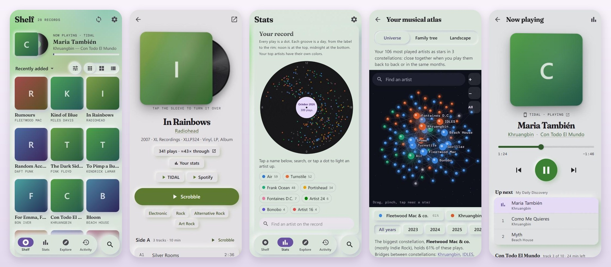
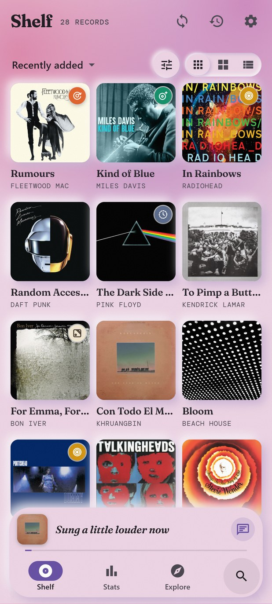
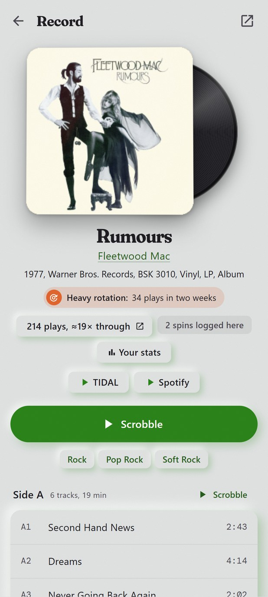
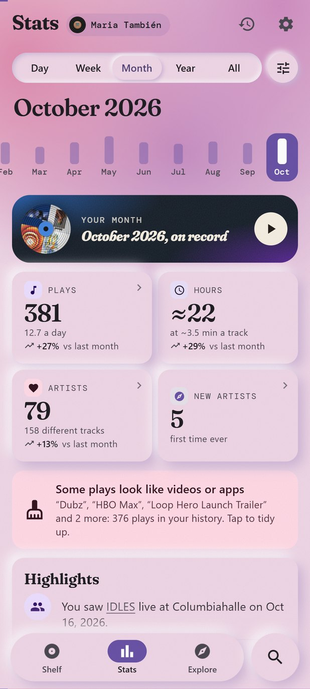
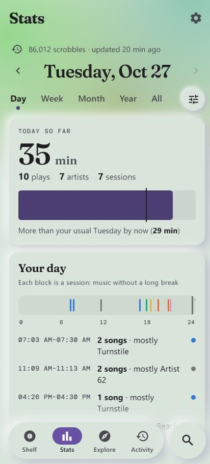
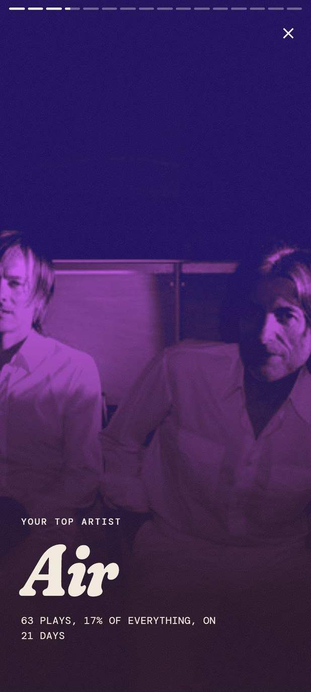
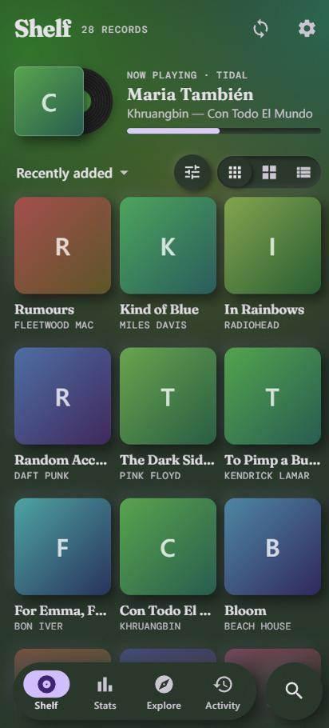

# Heavy Rotation

An Android app for your record shelf and everything else you listen to.

Heavy Rotation shows your [Discogs](https://www.discogs.com) collection as a shelf of covers and
scrobbles the records you play to [Last.fm](https://www.last.fm). It scrobbles what plays on your
phone as well, and it turns your whole Last.fm history into stats that know which records you own.

It is free and open source (MIT). You don't create an account, and there are no ads and no
tracking. The app talks to Discogs, Last.fm, Deezer, MusicBrainz and TIDAL directly, with no server
of its own in between, and your data stays on your phone.

## What it does

- One tap scrobbles a side, the whole record or a few tracks, timed to start now or earlier
  ("last night"), or to have just finished. Tracks are timed from their real lengths, Last.fm shows "now
  playing" while a side spins, the next side is one more tap, and all of it works offline.
- The phone is scrobbled too: TIDAL, Spotify or any other music app, by Last.fm's rules (half the
  track or 4 minutes). Shadow mode logs plays without sending them, so you can compare it with Pano
  Scrobbler first.
- Stats cover a day, a week, a month, a year or all time, and each period is compared with the one
  before: your plays as dots on a record, the period day by day as a calendar with your streaks, who
  you played when, new artists, songs on repeat, genre drift, decades and a top 10.
- The stats know your shelf. They show the records you own but rarely play, the albums you stream a
  lot but don't own yet, and how much of your listening was vinyl.
- Any period also comes as a Wrapped-style story you tap through, in the colors of your top album.
- Under Your taste, Stats also has a musical atlas of the artists you play back to back, you against
  everyone on Last.fm, your concerts and a map of your genres.
- The Explore tab suggests artists you haven't played yet, from who Last.fm's and Deezer's listeners
  find alike to the artists you play, each with the reason, plus a weekly discovery mix and new
  releases by your artists. It also has lost favorites, albums to rediscover and playlists to send
  to TIDAL.
- Stats comes as full-size blocks, as short cards that open full size, or as the classic long page.
  Explore comes in rows you scroll sideways, artist, album and genre pages in tabs you swipe
  between, and each can be one long page instead.
- A Now playing page for the phone shows the position, the controls, the music app's queue, the
  album the song is on and the lyrics. What plays can also sit in the bottom bar, with the line being
  sung.
- Concerts come from setlist.fm: a playlist of what an artist has been playing live lately, the
  setlist of one show, and the shows you were at, with what each did to your listening.
- The Fix names setting cleans up names before they're scrobbled ("Remastered", "feat." and your
  own rules).
- A home-screen widget shows what is playing now.
- The app uses Material You colors in light and dark, with two looks (Tinted soft and Soft glass).
  Covers tilt with the phone, and the records you own get a holo foil.

| | | |
| :---: | :---: | :---: |
|  |  |  |
| Your shelf | A record, ready to scrobble | A month, compared with the last |
|  |  |  |
| A day, for a handful of songs | The story | In the dark |

The screenshots show the app's demo data, with placeholder covers.

## Get it

Download the latest `HeavyRotation-x.y.apk` from the Releases page and open it on the phone
(Android 8 or newer). Android asks once to allow installs from the app you opened it with.

Play Protect may warn about an unknown app, mostly because the app isn't from the Play Store and
can use notification access (for phone scrobbling). Tap More details, then Install anyway.

To update, install a newer APK over the old one; your data stays. [Obtainium](https://obtainium.imranr.dev/)
can watch the Releases page and update the app for you.

## Set up

1. In Settings → Discogs, enter your Discogs username and tap Connect. For a private collection,
   use a personal token from [discogs.com/settings/developers](https://www.discogs.com/settings/developers) instead.
2. In Settings → Last.fm, tap Connect and allow access on Last.fm's page.
3. Open the Stats tab and tap Import history (about a minute per 20,000 scrobbles).
4. Optional: to scrobble the phone, set Settings → Phone scrobbling to Shadow and allow
   notification access. Switch it to On once it matches what you expect.
5. Optional: sign in to TIDAL in Settings → TIDAL for exact links and for playlists that go
   straight into your TIDAL.

[The guide](docs/GUIDE.md) covers every step and everything else the app does.

## Privacy

- Your history, collection and settings live in the app's storage on your phone. Backups are files
  you save yourself; keys, tokens and logins never go into them.
- The app only talks to Discogs, Last.fm, Deezer, MusicBrainz, LRCLIB (lyrics), TIDAL and setlist.fm
  (once you connect them) and the servers the covers come from. It has no server of its own, no
  analytics and no crash reporting.
- Notification access is how Android lets an app see what music apps play. Heavy Rotation uses it
  only to read the media players of the apps you switch on; it doesn't read your notifications.

## Credits

This application uses Discogs’ API but is not affiliated with, sponsored or endorsed by Discogs.
‘Discogs’ is a trademark of Zink Media, LLC.

Listening data powered by AudioScrobbler ([Last.fm](https://www.last.fm)). Covers, artist photos,
discographies and release years come from [Deezer](https://www.deezer.com), track lengths also from
[MusicBrainz](https://musicbrainz.org), lyrics from [LRCLIB](https://lrclib.net) and setlists from
[setlist.fm](https://www.setlist.fm). Exact links and playlists use [TIDAL](https://tidal.com).
Heavy Rotation isn't affiliated with any of them.

The fonts Fraunces and DM Mono are under the SIL Open Font License (`app/src/main/assets/ui/fonts`).

## How it was made

Heavy Rotation was designed and tested by its author on their own shelf and phone, and written
with the help of Claude, Anthropic's AI coding assistant.

## Building it yourself

[docs/DEVELOPING.md](docs/DEVELOPING.md) covers building the app, its own API keys, signing
releases, previewing the interface in a browser, the code layout and the terms of the services it
uses.

## License

MIT, see [LICENSE](LICENSE).
