# Heavy Rotation

An Android app for your record shelf, everything else you listen to, and what it all adds up to.

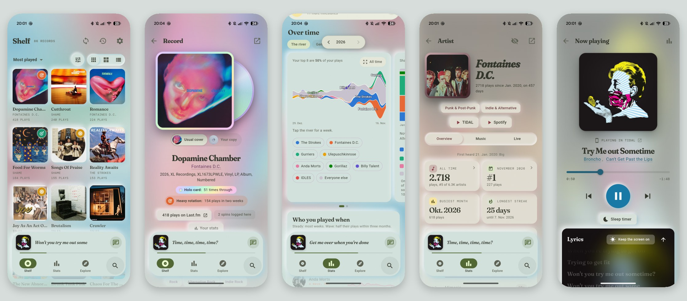

Hiii! Heavy Rotation has been a very fun project to work on so far - and I hope that you'll enjoy it too!

It started because I wanted better stats for my listening. I use TIDAL, which sadly has nothing
like Spotify Wrapped, but I've been scrobbling to [Last.fm](https://www.last.fm) for years, so I
figured I could make my own stats from that. Then I wanted my vinyl in there too: put a record on,
tap once, and have it count next to what the phone plays. And since the Last.fm app wasn't always
reliable at scrobbling from my phone, I added that as well. One thing led to another, and it got a
bit out of hand :)

So now Heavy Rotation shows your [Discogs](https://www.discogs.com) collection as a shelf of
covers, scrobbles the records you play and the music on your phone to Last.fm, and turns your whole
listening history into stats that know which records you own.

It is free and open source (MIT). You don't create an account, and there are no ads and no
tracking. The app talks to Discogs, Last.fm, Deezer, MusicBrainz and TIDAL directly, with no server
of its own in between, and your data stays on your phone.

## What it does

This is the short version. [The guide](docs/GUIDE.md) has everything.

- Scrobble your vinyl. Pick a record from your shelf and scrobble a side, the whole album or a few
  tracks, starting now, earlier ("last night") or just finished. Tracks are timed from their real
  lengths, the next side is one more tap, and all of it works offline.
- Scrobble your phone. TIDAL, Spotify or any other music app, by Last.fm's rules. If you already
  use another scrobbler, shadow mode only logs what it would send and then compares that with what
  reached Last.fm, so you can check it works for you before you switch.
- Dig through your stats. A day, a week, a month, a year or all time, each compared with the one
  before: a calendar with your streaks, who you played when, new artists, songs on repeat, genres,
  decades, where your artists are from and a top 10 by plays or by time listened. The period
  follows you down the page, so you can step through the years while looking at one chart, and
  the charts along time zoom out to your whole history.
- See what your shelf has to do with it. The stats show the records you own but rarely play, the
  albums you keep streaming but don't own yet, and how much of your listening was vinyl. Only
  vinyl turns the whole Stats tab into stats of the records you played.
- Watch it move. There is a race of your top artists through the years (and day by day within a
  month), a year as a river of artists, and a Wrapped-style story for any period in the colors of
  your top album.
- Open anything. Every artist, album, song and genre has its own page: plays over time, a song's
  chart run month by month, the discography, and a genre's lineup poster.
- Collect cards. A slightly silly one: songs you play a lot become collector cards (bronze at 10
  plays, up to holo at 100), and so do albums you play through, all in one binder.
- Make playlists from your history. Highlights are your most played songs of any year or month,
  or of one artist, as long as you like. They go straight into TIDAL, or anywhere else as a list
  you copy.
- Get ready for a concert. Before a show I used to look up what the artist had been playing
  lately and put a playlist together to get to know the songs. With setlist.fm connected, the app
  does that for me. It also knows the shows you were at and what each did to your listening.
- Find something to play. Explore suggests artists you haven't played yet, each with the reason,
  plus a weekly discovery mix, new releases by your artists, lost favorites and albums to
  rediscover.
- Sing along. Now playing has the lyrics in time (from LRCLIB) on the song's blurred cover, over
  the whole screen if you like, and the line being sung can sit in the bottom bar.
- Bring your older history. TIDAL's own record of your listening (the `streaming.csv` of its data
  export) can be imported, so the stats reach back to your first stream there, long before your
  Last.fm history starts. Importing Spotify's history the same way is planned.

And there is more in there: songs that Pixel's Now Playing recognises around you wait in a list to
scrobble or drop, Identify finds a song from ten seconds of sound, any album can be scrobbled by
hand after you heard it elsewhere, Fix names cleans up "Remastered" and "feat." before a scrobble
goes out, a home-screen widget shows what is playing, and the app wears Material You colors in
light and dark with two looks (Tinted soft and Soft glass).

| | | |
| :---: | :---: | :---: |
| 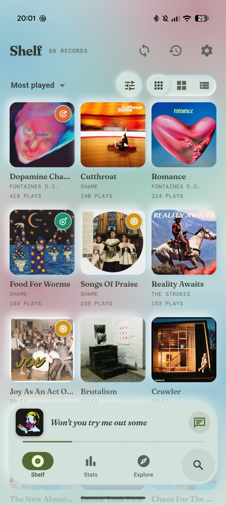 | 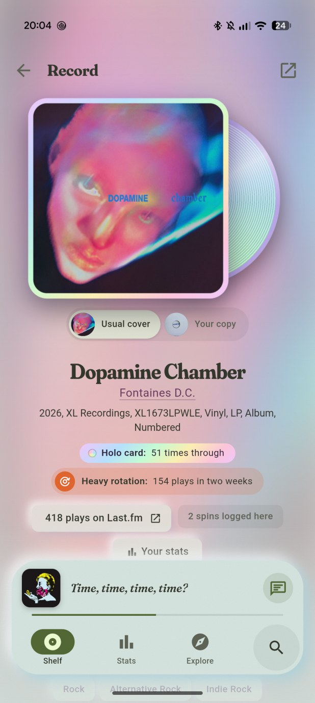 | 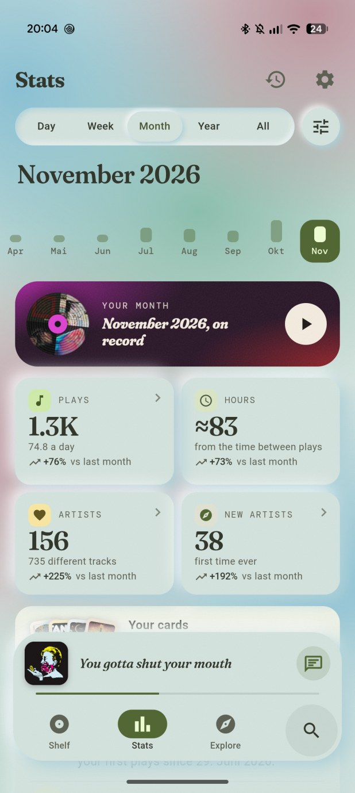 |
| Your shelf | A record from the shelf | A month, compared with the last |
| 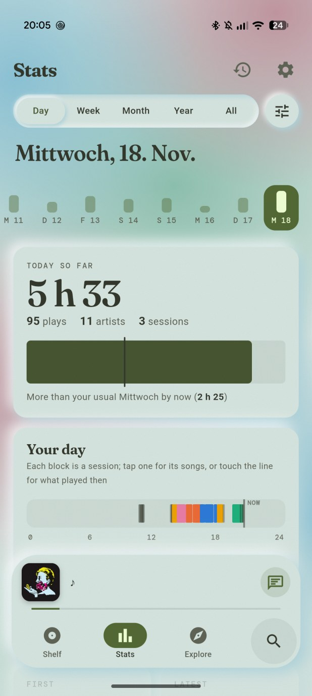 | 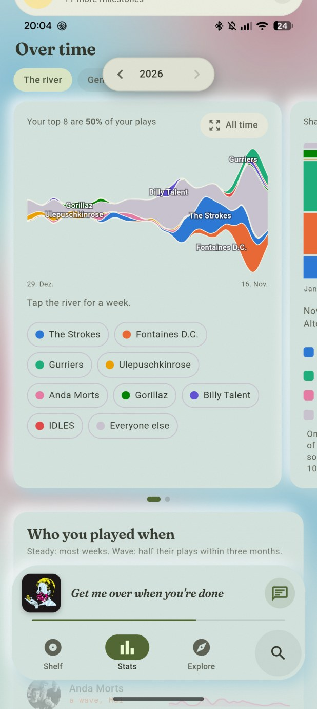 | 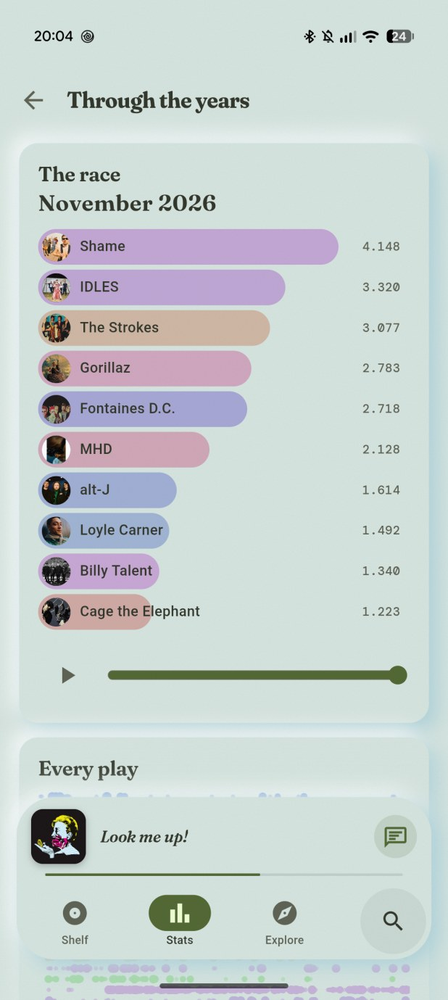 |
| Today so far | A year as a river | The race, through the years |
| 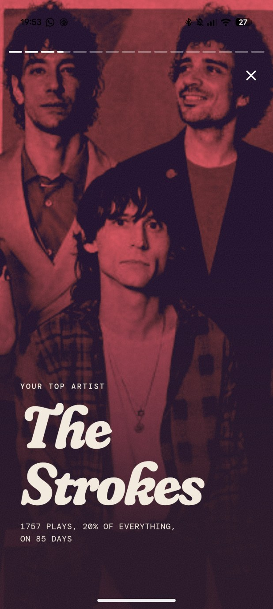 | 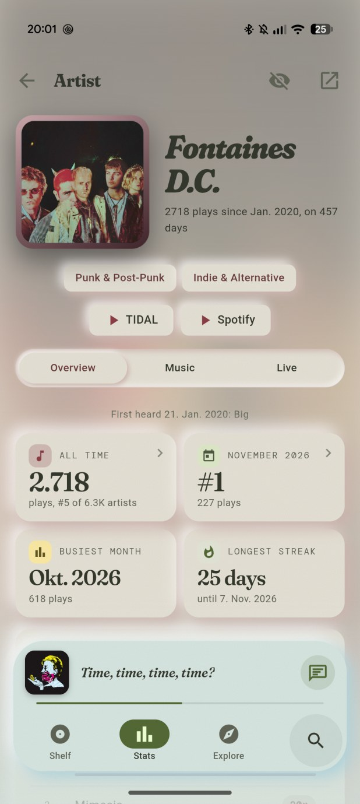 | 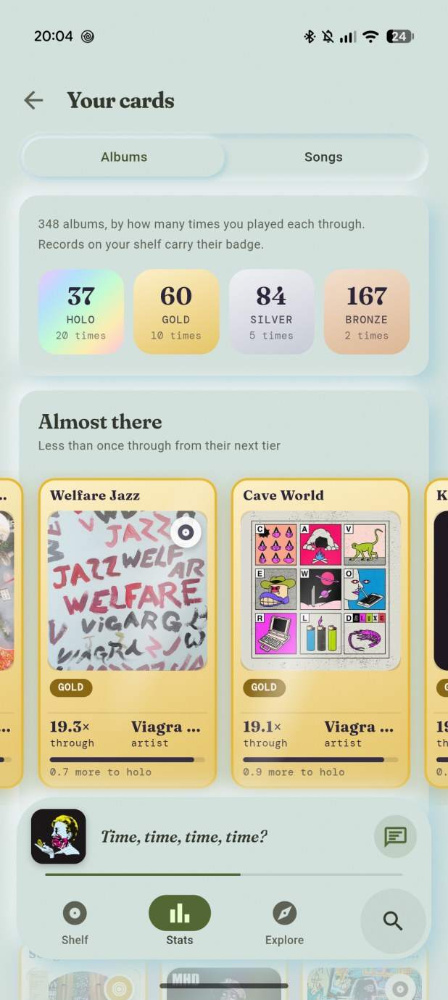 |
| The story | An artist | Your cards |
| 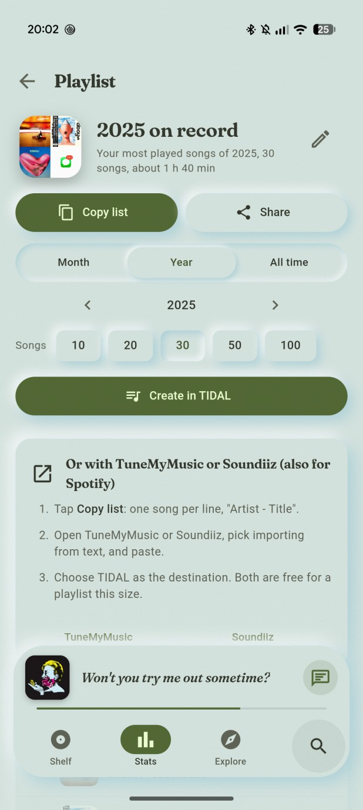 | 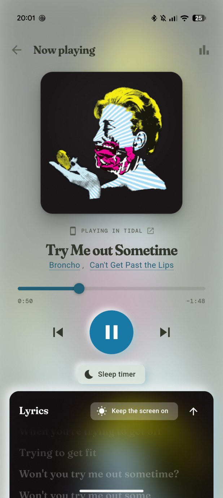 | 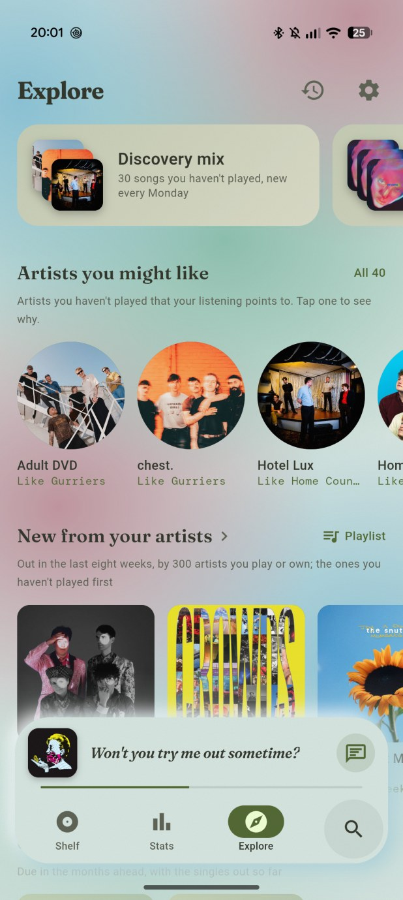 |
| Highlights of a year | Now playing, with lyrics | Explore |
| 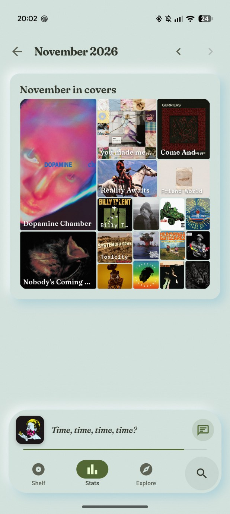 | 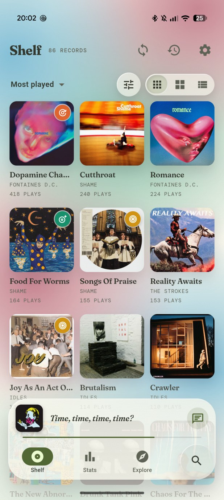 | 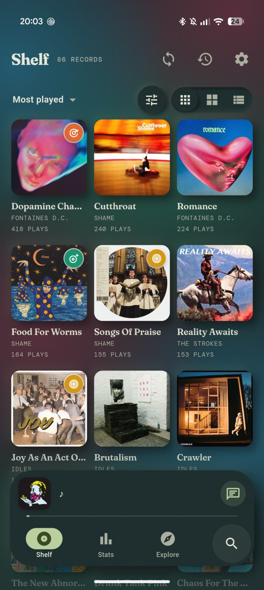 |
| A month in covers | Soft glass | In the dark |

The screenshots are from my own phone, so that is my shelf and my listening (and my phone speaks
German, hence "Okt."). The colors follow the song that is playing.

## Get it

Download the latest `HeavyRotation-x.y.apk` from the [Releases page](../../releases/latest) and
open it on the phone (Android 8 or newer). Android asks once to allow installs from the app you
opened it with.

Play Protect may warn about an unknown app, mostly because the app isn't from the Play Store and
can use notification access (for phone scrobbling). Tap More details, then Install anyway.

To update, install a newer APK over the old one; your data stays. [Obtainium](https://obtainium.imranr.dev/)
can watch the Releases page and update the app for you.

Android only for now, sorry!

## Set up

1. In Settings → Discogs, enter your Discogs username and tap Connect. For a private collection,
   use a personal token from [discogs.com/settings/developers](https://www.discogs.com/settings/developers) instead.
2. In Settings → Last.fm, tap Connect and allow access on Last.fm's page.
3. Open the Stats tab and tap Import history (about a minute per 20,000 scrobbles).
4. Optional: to scrobble the phone, set Settings → Phone scrobbling to Shadow and allow
   notification access. Switch it to On once it matches what you expect.
5. Optional: connect TIDAL in Settings → TIDAL for exact links and for playlists that go straight
   into your TIDAL. Until TIDAL approves the app, this needs your own free TIDAL developer app (the
   guide shows how); without it, the TIDAL buttons open TIDAL's search. Scrobbling what plays in
   TIDAL works either way.

[The guide](docs/GUIDE.md) covers every step and everything else the app does.

## Privacy

- Your history, collection and settings live in the app's storage on your phone. Backups are files
  you save yourself; keys, tokens and logins never go into them.
- The app only talks to Discogs, Last.fm, Deezer, MusicBrainz and its Cover Art Archive, LRCLIB (lyrics), TIDAL and setlist.fm
  (once you connect them), AudD (when you tap Identify) and the servers the covers come from. It has no server of its own, no
  analytics and no crash reporting.
- Notification access is how Android lets an app see what music apps play. Heavy Rotation uses it
  to read the media players of the apps you switch on and the songs Pixel's Now Playing recognises;
  it reads no other notifications.
- The microphone is used only when you tap Identify: ten seconds of sound go to AudD to name the
  song, and nothing is kept.
- A TIDAL history you import is read on the phone: only each stream's song, album, time and length
  are kept, in the app, and nothing of it is sent anywhere.

## Credits

This application uses Discogs’ API but is not affiliated with, sponsored or endorsed by Discogs.
‘Discogs’ is a trademark of Zink Media, LLC.

Listening data powered by AudioScrobbler ([Last.fm](https://www.last.fm)). Covers, artist photos,
discographies and release years come from [Deezer](https://www.deezer.com), track lengths and artists'
countries also from [MusicBrainz](https://musicbrainz.org), the covers Deezer doesn't have from the
[Cover Art Archive](https://coverartarchive.org), lyrics from [LRCLIB](https://lrclib.net) and setlists from
[setlist.fm](https://www.setlist.fm). Identify uses [AudD](https://audd.io). Exact links and playlists use [TIDAL](https://tidal.com).
Heavy Rotation isn't affiliated with any of them.

The fonts Fraunces and DM Mono are under the SIL Open Font License (`app/src/main/assets/ui/fonts`).
The world map's outlines are from [Natural Earth](https://www.naturalearthdata.com) (public domain).

## Feedback

I'd love to hear from you: what works, what doesn't, and what you'd like it to do. I'm sure there
are still bugs. Open an [issue](../../issues) for bugs and ideas alike, especially if you have
ideas for other fun things to do with Last.fm data.

## How it was made

I'm not an Android developer. I designed Heavy Rotation and tested it on my own shelf and phone,
and built it with a lot of help from Claude, Anthropic's AI coding assistant. I couldn't have made
something like this from scratch otherwise, and it has been a really fun project to work on and
learn from.

## Building it yourself

[docs/DEVELOPING.md](docs/DEVELOPING.md) covers building the app, its own API keys, signing
releases, previewing the interface in a browser, the code layout and the terms of the services it
uses.

## License

MIT, see [LICENSE](LICENSE).
